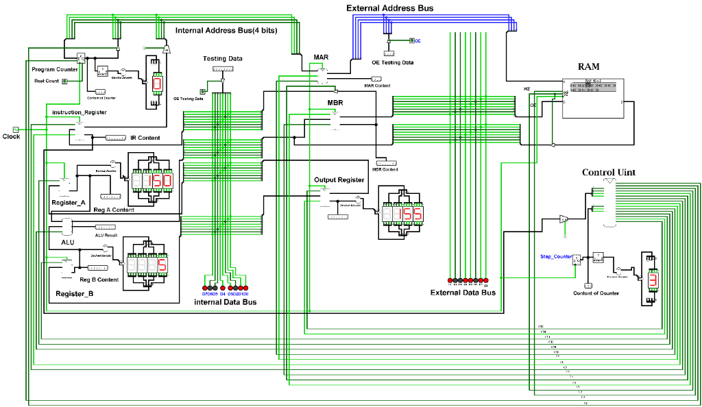
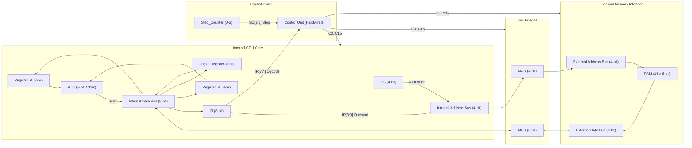
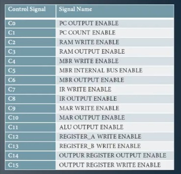
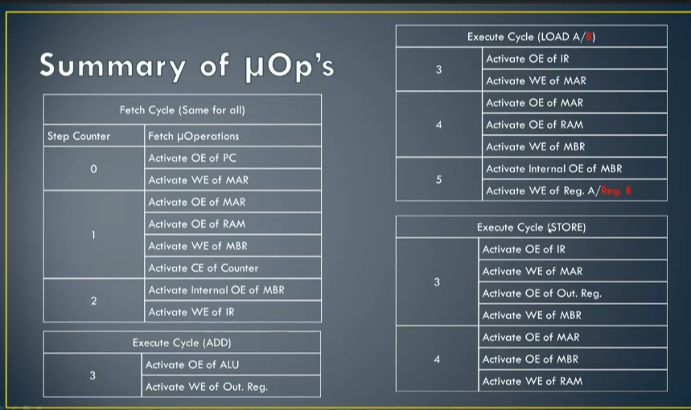

# 8-Bit CPU Simulator

[](https://github.com/logisim-evolution/logisim-evolution)
[](#key-features--specifications)
[-orange.svg)](#key-features--specifications)
[-purple.svg)](#control-signals-c0c15)

A custom-built, gate-level **8-bit CPU** featuring a hardwired Control Unit, dual-bus architecture (Internal & External Address/Data buses), 16×8-bit RAM, an 8-bit ALU, and real-time 7-segment decimal visualization, designed and simulated in **Logisim-evolution v4.1.0**.

<p align="center">
  
</p>

<p align="center">
  <em>Top-level CPU circuit during simulation: <code>Register_A = 150</code>, <code>Register_B = 5</code>, <code>Output Register = 155</code>, and <code>Step_Counter = 3</code>.</em>
  <br />
  <a href="assets/CPU_99.mp4">Watch Simulation Demo (CPU_99.mp4)</a>
</p>

---

## Table of Contents

- [Key Features & Specifications](#key-features--specifications)
- [System Architecture](#system-architecture)
- [Subcircuits Overview](#subcircuits-overview-circuitcpu_tcirc)
- [Instruction Set Architecture (ISA)](#instruction-set-architecture-isa)
- [Control Signals (`C0`–`C15`)](#control-signals-c0c15)
- [Micro-Operations (μOps) & Control Unit Truth Table](#micro-operations-μops--control-unit-truth-table)
- [Sample Program Walkthrough (`memory/RAM`)](#sample-program-walkthrough-memoryram)
- [Project Structure](#project-structure)
- [Getting Started (How to Run)](#getting-started-how-to-run)
- [Author](#author)

---

## Key Features & Specifications

| Specification | Details |
| :--- | :--- |
| **Data Path Width** | 8-bit (`Internal Data Bus` + `External Data Bus` with LED indicators `D7`–`D0`) |
| **Address Bus Width** | 4-bit (`Internal Address Bus` + `External Address Bus`, 16 addressable locations `0x0`–`0xF`) |
| **Memory** | 16 × 8-bit asynchronous-read `RAM` |
| **Registers** | `Program Counter` (4-bit), `MAR` (4-bit), `MBR` (8-bit), `IR` (8-bit), `Register_A` (8-bit), `Register_B` (8-bit), `Output Register` (8-bit) |
| **ALU** | 8-bit Adder (`Register_A + Register_B`) with tri-state output buffer and `Carry_out` |
| **Control Unit** | Hardwired combinational decoder (`OPC[3:0]` + `SC[2:0]` → 16 control lines `C0`–`C15`) |
| **Instruction Cycle** | 6-step cycle (`Step_Counter` counts `0` to `5`: `T0`–`T2` Fetch, `T3`–`T5` Execute) |
| **Display** | Custom ROM-based `DecimalDecoder` (256×32-bit ROM) driving 7-segment displays (`0`–`255`) |

---

## System Architecture

The processor separates internal execution from external memory access using dedicated **MAR** (Memory Address Register) and **MBR** (Memory Buffer Register) bridges between the internal and external buses.



---

## Subcircuits Overview (`circuit/CPU_t.circ`)

All CPU components are built hierarchically inside [`circuit/CPU_t.circ`](circuit/CPU_t.circ):

| Subcircuit | Description |
| :--- | :--- |
| **`CPU`** | Top-level 8-bit processor integrating all modules, internal/external buses, RAM, bus LEDs, and 7-segment displays. |
| **`Control_Uint`** | Hardwired combinational logic unit decoding the 4-bit Opcode (`OPC3`–`OPC0`) and 3-bit Step Counter (`SC2`–`SC0`) into 16 control signals (`C0`–`C15`). |
| **`ALU`** | 8-bit Adder (`Reg_A + Reg_B`) with a tri-state `Controlled Buffer` (`OE`), live `ALU_Result` output, and `Carry_out`. |
| **`Register8bit`** | 8-bit register constructed hierarchically from 8 × `Memory` cells (`Din`, `WE`, `OE`, `Clock`, `Reset`, `Dout`, `StoredData`). |
| **`MAR`** | 4-bit Memory Address Register constructed from 4 × `Memory` cells. |
| **`Memory`** | Gate-level 1-bit register cell built with a D Flip-Flop, write-enable feedback logic (`NOT`, `AND`, `OR`), asynchronous `Reset`, and tri-state output buffer. |
| **`DecimalDecoder`** | 256×32-bit ROM lookup table converting 8-bit unsigned values (`0`–`255`) into 4-digit 7-segment display encodings. |

---

## Instruction Set Architecture (ISA)

Each instruction is **8 bits (1 byte)** wide, divided into a 4-bit **Opcode** and a 4-bit **Memory Address**:

```text
+-----------------------+-------------------------+
|      Bits [7:4]       |       Bits [3:0]        |
|    Opcode (4 bits)    | Memory Address (4 bits) |
+-----------------------+-------------------------+
```

| Opcode (Bin) | Opcode (Hex) | Mnemonic | Syntax | Operation |
| :---: | :---: | :--- | :--- | :--- |
| `0000` | `0x0` | `LOAD A` | `LOAD A, [addr]` | `Register_A ← RAM[addr]` |
| `0001` | `0x1` | `LOAD B` | `LOAD B, [addr]` | `Register_B ← RAM[addr]` |
| `0010` | `0x2` | `ADD` | `ADD` | `Output Register ← Register_A + Register_B` |
| `0011` | `0x3` | `STORE` | `STORE [addr]` | `RAM[addr] ← Output Register` |

---

## Control Signals (`C0`–`C15`)

The hardwired Control Unit drives 16 active-high control lines (`C0`–`C15`) across the datapath:

| Signal | Signal Name | Target Module | Description |
| :---: | :--- | :--- | :--- |
| **`C0`** | `PC OUTPUT ENABLE` | Program Counter | Places `PC` value onto the Internal Address Bus. |
| **`C1`** | `PC COUNT ENABLE` | Program Counter | Increments `PC` on the clock edge. |
| **`C2`** | `RAM WRITE ENABLE` | RAM | Writes data from the External Data Bus into `RAM[MAR]`. |
| **`C3`** | `RAM OUTPUT ENABLE` | RAM | Drives `RAM[MAR]` contents onto the External Data Bus. |
| **`C4`** | `MBR WRITE ENABLE` | MBR | Latches data into `MBR` (from External or Internal Data Bus). |
| **`C5`** | `MBR INTERNAL BUS ENABLE` | MBR | Drives `MBR` contents onto the Internal Data Bus. |
| **`C6`** | `MBR OUTPUT ENABLE` | MBR | Drives `MBR` contents onto the External Data Bus. |
| **`C7`** | `IR WRITE ENABLE` | Instruction Register | Latches instruction byte from Internal Data Bus into `IR`. |
| **`C8`** | `IR OUTPUT ENABLE` | Instruction Register | Places `IR[3:0]` operand address onto the Internal Address Bus. |
| **`C9`** | `MAR WRITE ENABLE` | MAR | Latches 4-bit address from the Internal Address Bus into `MAR`. |
| **`C10`** | `MAR OUTPUT ENABLE` | MAR | Places `MAR` address onto the External Address Bus. |
| **`C11`** | `ALU OUTPUT ENABLE` | ALU | Drives `Register_A + Register_B` sum onto the Internal Data Bus. |
| **`C12`** | `REGISTER_A WRITE ENABLE` | Register A | Latches Internal Data Bus value into `Register_A`. |
| **`C13`** | `REGISTER_B WRITE ENABLE` | Register B | Latches Internal Data Bus value into `Register_B`. |
| **`C14`** | `OUTPUT REGISTER OUTPUT ENABLE` | Output Register | Drives `Output Register` value onto the Internal Data Bus. |
| **`C15`** | `OUTPUT REGISTER WRITE ENABLE` | Output Register | Latches Internal Data Bus value into `Output Register`. |

<details>
<summary>View Reference Control Signals Table (control_signals.jpg)</summary>



</details>

---

## Micro-Operations (μOps) & Control Unit Truth Table

Every instruction executes over a 6-step cycle controlled by `Step_Counter` (`T0`–`T5`):
- **Fetch Cycle (`T0`–`T2`):** Identical for all instructions. Fetches the next instruction from `RAM[PC]` into `IR` and increments `PC`.
- **Execute Cycle (`T3`–`T5`):** Decodes `OPC[3:0]` (`IR[7:4]`) and asserts the corresponding control signals.

### Control Signal Truth Table

| Phase / Instruction | Opcode (`OPC3..0`) | Step (`SC2..0`) | `C0` | `C1` | `C2` | `C3` | `C4` | `C5` | `C6` | `C7` | `C8` | `C9` | `C10` | `C11` | `C12` | `C13` | `C14` | `C15` | RTL Micro-Operation |
| :--- | :---: | :---: | :-: | :-: | :-: | :-: | :-: | :-: | :-: | :-: | :-: | :-: | :-: | :-: | :-: | :-: | :-: | :-: | :--- |
| **Fetch (`T0`)** | `XXXX` | `000` (0) | **1** | 0 | 0 | 0 | 0 | 0 | 0 | 0 | 0 | **1** | 0 | 0 | 0 | 0 | 0 | 0 | `MAR ← PC` |
| **Fetch (`T1`)** | `XXXX` | `001` (1) | 0 | **1** | 0 | **1** | **1** | 0 | 0 | 0 | 0 | 0 | **1** | 0 | 0 | 0 | 0 | 0 | `MBR ← RAM[MAR]; PC ← PC + 1` |
| **Fetch (`T2`)** | `XXXX` | `010` (2) | 0 | 0 | 0 | 0 | 0 | **1** | 0 | **1** | 0 | 0 | 0 | 0 | 0 | 0 | 0 | 0 | `IR ← MBR` |
| **`LOAD A` (`T3`)** | `0000` | `011` (3) | 0 | 0 | 0 | 0 | 0 | 0 | 0 | 0 | **1** | **1** | 0 | 0 | 0 | 0 | 0 | 0 | `MAR ← IR[3:0]` |
| **`LOAD A` (`T4`)** | `0000` | `100` (4) | 0 | 0 | 0 | **1** | **1** | 0 | 0 | 0 | 0 | 0 | **1** | 0 | 0 | 0 | 0 | 0 | `MBR ← RAM[MAR]` |
| **`LOAD A` (`T5`)** | `0000` | `101` (5) | 0 | 0 | 0 | 0 | 0 | **1** | 0 | 0 | 0 | 0 | 0 | 0 | **1** | 0 | 0 | 0 | `Register_A ← MBR` |
| **`LOAD B` (`T3`)** | `0001` | `011` (3) | 0 | 0 | 0 | 0 | 0 | 0 | 0 | 0 | **1** | **1** | 0 | 0 | 0 | 0 | 0 | 0 | `MAR ← IR[3:0]` |
| **`LOAD B` (`T4`)** | `0001` | `100` (4) | 0 | 0 | 0 | **1** | **1** | 0 | 0 | 0 | 0 | 0 | **1** | 0 | 0 | 0 | 0 | 0 | `MBR ← RAM[MAR]` |
| **`LOAD B` (`T5`)** | `0001` | `101` (5) | 0 | 0 | 0 | 0 | 0 | **1** | 0 | 0 | 0 | 0 | 0 | 0 | 0 | **1** | 0 | 0 | `Register_B ← MBR` |
| **`ADD` (`T3`)** | `0010` | `011` (3) | 0 | 0 | 0 | 0 | 0 | 0 | 0 | 0 | 0 | 0 | 0 | **1** | 0 | 0 | 0 | **1** | `Output Register ← Register_A + Register_B` |
| **`ADD` (`T4`–`T5`)** | `0010` | `100`–`101` (4–5) | 0 | 0 | 0 | 0 | 0 | 0 | 0 | 0 | 0 | 0 | 0 | 0 | 0 | 0 | 0 | 0 | Idle (no-op) |
| **`STORE` (`T3`)** | `0011` | `011` (3) | 0 | 0 | 0 | 0 | **1** | 0 | 0 | 0 | **1** | **1** | 0 | 0 | 0 | 0 | **1** | 0 | `MAR ← IR[3:0]; MBR ← Output Register` |
| **`STORE` (`T4`)** | `0011` | `100` (4) | 0 | 0 | **1** | 0 | 0 | 0 | **1** | 0 | 0 | 0 | **1** | 0 | 0 | 0 | 0 | 0 | `RAM[MAR] ← MBR` |
| **`STORE` (`T5`)** | `0011` | `101` (5) | 0 | 0 | 0 | 0 | 0 | 0 | 0 | 0 | 0 | 0 | 0 | 0 | 0 | 0 | 0 | 0 | Idle (no-op) |

<details>
<summary>View Reference Micro-Operations Slide (micro_ops.jpg)</summary>



</details>

---

## Sample Program Walkthrough (`memory/RAM`)

The included [`memory/RAM`](memory/RAM) image contains a continuous accumulator program:

```text
v3.0 hex words addressed
0: 0c 1d 20 3c 00 00 00 00 00 00 00 00 08 05 00 00
```

### Disassembly

| RAM Address | Hex Byte | Instruction / Data | Description |
| :---: | :---: | :--- | :--- |
| `0x0` | `0x0C` | `LOAD A, [0xC]` | Loads accumulator value from `RAM[0xC]` (initial `0x08` = `8`) into `Register_A`. |
| `0x1` | `0x1D` | `LOAD B, [0xD]` | Loads constant increment from `RAM[0xD]` (`0x05` = `5`) into `Register_B`. |
| `0x2` | `0x20` | `ADD` | Computes `Register_A + Register_B` and latches the sum into `Output Register`. |
| `0x3` | `0x3C` | `STORE [0xC]` | Writes `Output Register` back into `RAM[0xC]`. |
| `0xC` | `0x08` | Data (`8`) | Accumulator variable (updated each loop iteration). |
| `0xD` | `0x05` | Data (`5`) | Step increment constant (`5`). |

Because the 4-bit Program Counter is configured with `max = 0x3`, it wraps automatically (`0 → 1 → 2 → 3 → 0`), continuously adding `5` to `RAM[0xC]` on each iteration (`8 → 13 → 18 → ... → 150 → 155`, as captured in the top-level schematic screenshot).

---

## Project Structure

```text
CPU-Simulator/
├── .gitignore
├── README.md
├── assets/
│   ├── CPU_99.mp4             # Simulation demo video
│   ├── control_signals.jpg    # Reference control signals table
│   ├── cpu_schematic.png      # Top-level CPU schematic screenshot
│   └── micro_ops.jpg          # Summary of micro-operations slide
├── circuit/
│   └── CPU_t.circ             # Logisim-evolution v4.1.0 project file
└── memory/
    ├── RAM                    # Primary v3.0 hex RAM image (accumulator program)
    └── RAM_V1                 # Legacy v2.0 raw RAM image
```

---

## Getting Started (How to Run)

### Prerequisites
- [**Logisim-evolution v4.1.0**](https://github.com/logisim-evolution/logisim-evolution) (or newer)

### Steps
1. **Clone the repository:**
   ```bash
   git clone https://github.com/alwaleed-abu-taleb/CPU-Simulator.git
   cd CPU-Simulator
   ```
2. **Open the circuit:**
   Launch Logisim-evolution and open [`circuit/CPU_t.circ`](circuit/CPU_t.circ).
3. **Select the top-level processor:**
   > **Important:** The `.circ` file defaults to opening the `Memory` subcircuit. In the left-hand **Explorer** panel, double-click **`CPU`** to view the complete processor.
4. **Load the RAM image:**
   Right-click the **RAM** component → **Load Image...** → select [`memory/RAM`](memory/RAM).
5. **Run the simulation:**
   Enable clock ticking via **Simulate → Auto-Tick Enabled** (or press `Ctrl+K` / tick the `Clock` manually with `Ctrl+T`) and observe the registers, bus LEDs, and 7-segment displays update in real time.

---

## Author

**Alwaleed Abu Taleb** — [@alwaleed-abu-taleb](https://github.com/alwaleed-abu-taleb)
